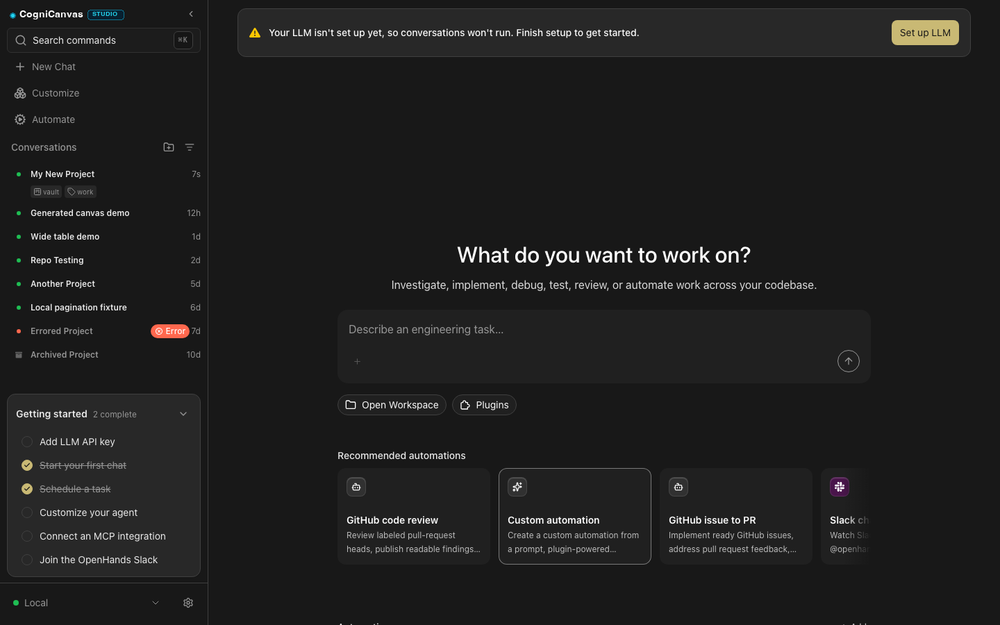
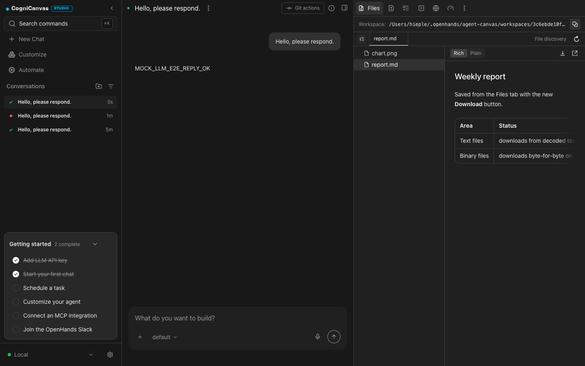
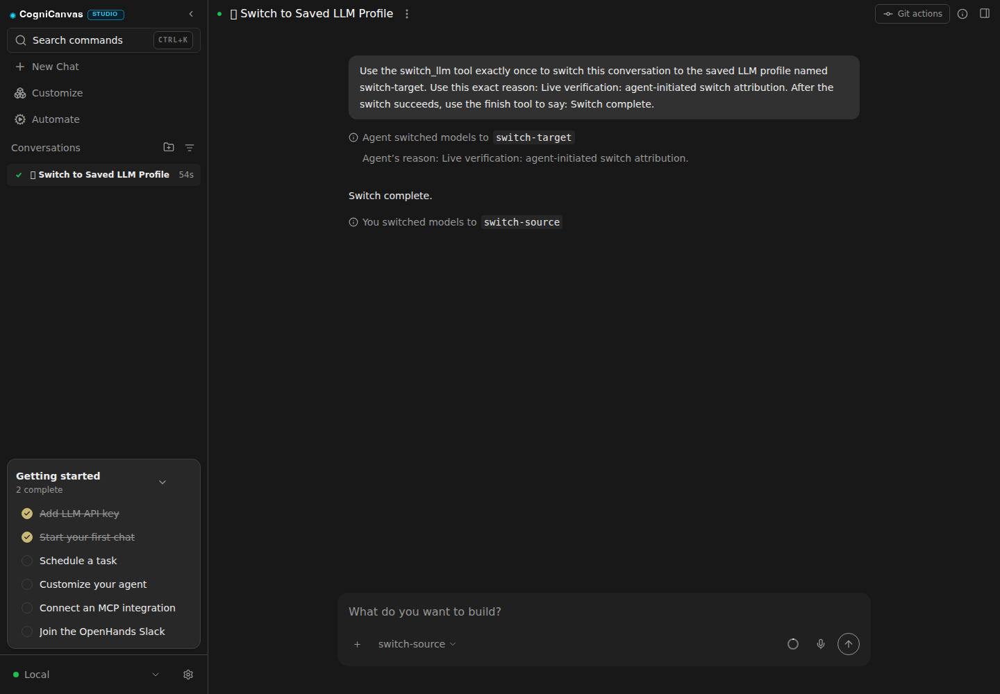
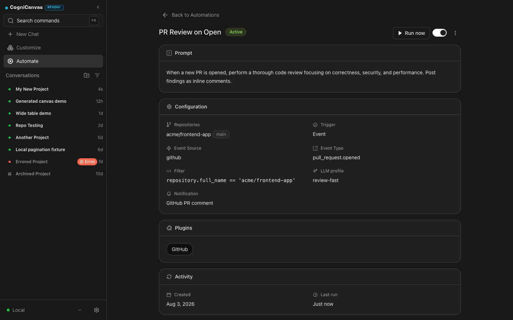

<a name="readme-top"></a>

<div align="center">

  

  # ⚡ CogniCanvas

  ### **The Next-Gen Visual Cockpit for Autonomous AI Coding Agents**

  <p align="center">
    <strong>Turn independent AI agents into an orchestrated, observable engineering powerhouse.</strong>
  </p>

  <p align="center">
    Orchestrate Claude Code, OpenAI Codex, Google Gemini, OpenCode, or any ACP-compliant agent in a live visual cockpit with an embedded Monaco editor, interactive terminal, real-time web inspector, and automated task planner.
  </p>

  <!-- Animated-style Badges -->
  <p align="center">
    <a href="https://github.com/asmohamedarfeen/new22"></a>
    <a href="https://github.com/asmohamedarfeen/new22"></a>
    <a href="https://github.com/asmohamedarfeen/new22"></a>
    <a href="https://github.com/asmohamedarfeen/new22/blob/main/LICENSE"></a>
  </p>

  <p align="center">
    <a href="#-quick-tour">✨ Quick Tour</a> •
    <a href="#-core-features">🚀 Features</a> •
    <a href="#-workflow-comparison">📊 Why CogniCanvas?</a> •
    <a href="#-getting-started">⚡ Quickstart</a> •
    <a href="#-architecture">🏗️ Architecture</a> •
    <a href="#-license">📜 License</a>
  </p>

  <br />

  <!-- Hero Workspace Screenshot -->
  

</div>

---

## 🌟 Why CogniCanvas?

Terminal-only coding agents are powerful, but developers lose context staring at text output while files are changed blindly in the dark. 

**CogniCanvas fixes this.** It acts as an **always-on flight deck** where you can observe, guide, and collaborate with autonomous AI software engineers in real time.

```
┌──────────────────────────────────────────────────────────────────────────────┐
│                                 COGNICANVAS                                  │
│                                                                              │
│   ┌─────────────────────┐  ┌──────────────────────────────────────────────┐  │
│   │  CONVERSATION & AI  │  │            INTERACTIVE WORKSPACE             │  │
│   │                     │  │                                              │  │
│   │  • Task Breakdown   │  │  [📂 Files]   [💻 Terminal]   [🌐 Browser]    │  │
│   │  • Thought Streaming│  │                                              │  │
│   │  • Branching Forks  │  │  • Real-time Diff & Monaco Code Editor       │  │
│   │  • Tool Traces      │  │  • Interactive ANSI Shell & PTY Stream       │  │
│   │  • Multi-Model Hub  │  │  • Headless/Live DOM Inspection & Screen     │  │
│   └─────────────────────┘  └──────────────────────────────────────────────┘  │
└──────────────────────────────────────────────────────────────────────────────┘
```

---

## ✨ Quick Tour

### 🖥️ 1. Multi-Surface Visual Cockpit
Observe agent actions live across dedicated surfaces. The split cockpit gives you complete visibility into files touched, commands executed, and browser actions in real time.

<div align="center">
  
</div>

<br />

### 📂 2. Monaco Code Editor & Live File Explorer
Review full source code changes, jump between project trees with fuzzy matching, and inspect side-by-side diffs before agents commit their work.

<div align="center">
  
</div>

<br />

### 🧠 3. Dynamic Multi-Model & Backend Orchestration
Seamlessly switch between AI models (Claude 3.7 / 3.5 Sonnet, GPT-4o, Codex, Gemini Flash/Pro, DeepSeek R1) or connect to local, containerized, or cloud agent runtimes on the fly.

<div align="center">
  
</div>

<br />

### ⚡ 4. Autonomous Task Workflows & Planning
Decompose complex software engineering requests into manageable steps. Pause, resume, fork conversations with "Branch from here", or run automated scheduled routines.

<div align="center">
  
</div>

<br />

### 🎨 5. Redesigned Modern UI & Brand Mark
- **Neural Prism Brand Mark**: Custom vector emblem engineered with radiant cyan and electric violet isometric facets.
- **Deep Obsidian Surfaces**: Modern high-contrast dark theme (`#070a13` / `#0d1424`) with radiant accents and border glows.
- **Streamlined Navigation Rail**: Persistent branding with animated studio indicators and fluid collapsible layout.

---

## 📊 Workflow Comparison

| Capability | Raw CLI Agents | Standard Chatbots | ⚡ **CogniCanvas** |
| :--- | :---: | :---: | :---: |
| **Real-time File Tree & Code Diff** | ❌ None | ❌ Copy-paste only | ✅ **Native Monaco Editor & Diffs** |
| **Embedded Shell Execution** | ⚠️ Blind console | ❌ None | ✅ **Interactive PTY Terminal** |
| **Live Browser Preview & DOM Snapshots**| ❌ None | ❌ None | ✅ **Built-in Browser Inspector** |
| **Branch Conversations From Any Step** | ❌ None | ❌ Linear only | ✅ **Instant Tree Branching** |
| **Model & Backend Hot-Swapping** | ❌ Restart CLI | ⚠️ Limited | ✅ **Live Profile Switcher** |
| **Model Context Protocol (MCP) Support** | ⚠️ Complex config | ❌ None | ✅ **One-Click MCP Manager** |
| **Self-Hosted & Desktop App** | ⚠️ Script-only | ❌ Cloud only | ✅ **Web + Docker + Electron** |

---

## 🚀 Key Features

* 💻 **Interactive Terminal**: Full ANSI color support, process signaling, split-terminal views, and execution telemetry.
* 🌐 **Live Web Browser Inspector**: Renders web applications created or modified by agents; supports auto-screenshot captures and DOM element picking.
* 🌿 **Conversation Branching**: Fork from any historical message (`Branch from here`) to explore alternative implementation paths without losing context.
* 🔌 **Model Context Protocol (MCP)**: Plug in SQLite, GitHub, Slack, filesystem tools, and custom REST API connectors instantly.
* 🌍 **Global Localization**: Fully translated across 15+ languages including English, Spanish, German, French, Japanese, and Chinese.
* 🖥️ **Universal Deployment**: Run as a high-speed web application or as a packaged native desktop application via Electron.

---

## ⚡ Getting Started

### Prerequisites

Ensure you have the following installed:
* **Node.js**: `>= 24.0.0`
* **npm**: `>= 11.0.0`

### 1. Clone & Install

```bash
git clone https://github.com/asmohamedarfeen/new22.git
cd new22
npm install
```

### 2. Environment Setup

```bash
cp .env.sample .env
```

Customize `.env` with your preferred Agent Server endpoint:
```env
VITE_AGENT_SERVER_URL=http://localhost:8000
VITE_APP_MODE=web
```

### 3. Launch Development Server

```bash
npm run dev
```

Your CogniCanvas cockpit will be live at `http://localhost:3000` (or `http://localhost:5173`).

---

## 📦 Build Targets

### 🌐 Build Web Application
```bash
npm run build:app
```

### 🖥️ Build Desktop Application (Electron)
```bash
npm run build:desktop
```
Creates optimized desktop binaries for macOS, Linux, and Windows in `dist-electron/`.

### 🐳 Run with Docker
```bash
docker build -t cognicanvas -f docker/Dockerfile .
docker run -p 3000:80 cognicanvas
```

---

## 🏗️ Architecture

```
cognicanvas/
├── src/
│   ├── api/                  # Agent Server REST & WebSocket protocol engine
│   ├── components/
│   │   ├── browser/          # In-app browser inspector & screenshot engine
│   │   ├── conversation/     # Chat stream, message cards & branch forks
│   │   ├── files/            # File explorer, tree view & diff viewers
│   │   ├── terminal/         # Embedded Xterm.js terminal emulator
│   │   └── settings/         # Agent profiles, MCP servers & connections
│   ├── context/              # App-wide providers (Theme, Layout, Sound)
│   ├── hooks/                # High-performance reactive state hooks
│   ├── i18n/                 # Multi-language translation engine
│   ├── routes/               # React Router layouts & navigation
│   └── stores/               # Zustand & TanStack Query cache stores
├── electron/                 # Electron main process & desktop integration
├── docs/assets/              # High-resolution application screenshots
└── tests/                    # Playwright E2E and Vitest test suites
```

---

## ⌨️ Shortcuts & Hotkeys

| Shortcut | Action |
| :--- | :--- |
| <kbd>⌘</kbd> + <kbd>K</kbd> / <kbd>Ctrl</kbd> + <kbd>K</kbd> | Open Command Palette / Model Switcher |
| <kbd>⌘</kbd> + <kbd>P</kbd> / <kbd>Ctrl</kbd> + <kbd>P</kbd> | Quick File Search in Workspace |
| <kbd>⌘</kbd> + <kbd>B</kbd> / <kbd>Ctrl</kbd> + <kbd>B</kbd> | Toggle Navigation Sidebar |
| <kbd>⌘</kbd> + <kbd>`</kbd> / <kbd>Ctrl</kbd> + <kbd>`</kbd> | Focus Embedded Terminal |

---

## 📜 License

This project is licensed under the **MIT License**. See the [LICENSE](./LICENSE) file for details.

```
The MIT License (MIT)
Copyright (c) 2026 Mohamed Arfeen <asmohamed.arfeen@gmail.com>
```

---

<div align="center">
  <p>Crafted with ❤️ by <strong>Mohamed Arfeen</strong></p>
  <p>⭐ Star this repository if you find it helpful!</p>
  <a href="#readme-top">⬆️ Back to Top</a>
</div>
